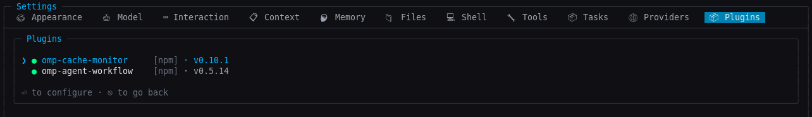
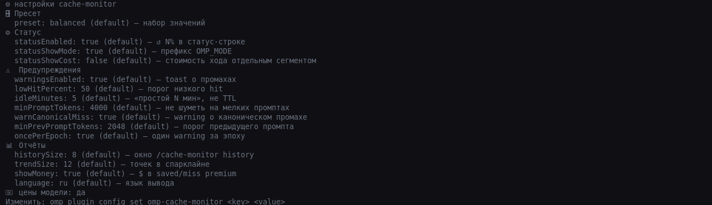

# omp-cache-monitor

English | [Русский](docs/README.ru.md)

OMP extension: prefix-cache hit rate in the status line, miss warnings, and the
`/cache-monitor` command (`history` shows the last 8 turns, `costs` breaks the
session cost down by journal entry type, `settings` shows plugin settings,
`help` prints a short reference).

It changes nothing in settings or requests: it reads the completed turn usage
(`turn_end.message.usage`) and the session journal
(`sessionManager.getEntries()`), then publishes a status. An error inside the
handler never breaks the turn.

## What it shows

Status line (TUI only), key `cache-monitor`:

```
cache-safe ↺ 98%
```

The mode comes from `OMP_MODE` (set by `omp-mode`); without a mode it is
`↺ 98%`, before the first turn `↺ …`, and with a zero denominator `↺ n/a`
(no `%`). With `statusShowCost: true` a second key `cache-monitor-cost`
publishes the last turn cost as `$0.0027` (4 decimals); the hit line is
unchanged, and the cost segment appears only after a completed turn.

`/cache-monitor` prints one line with the mode, model, thinking level, last
turn with `saved` and `miss premium`, the trend, and session totals:

```
режим: cache-safe · test/model-a · thinking high · ход: ↺ 25% · in 3000 · cacheRead 1000 · cacheWrite 0 · $0.0200 · saved $0.0027 · miss premium: $0.0081 (3000 tok) · тренд: ▁▃ · сессия: $0.0700, ходов 2, ↺ 11.1%, saved $0.0027, miss premium $0.0081 (3000 tok)
```

| Field | Meaning |
|---|---|
| _(labels)_ | Command output stays Russian (`режим`, `ход`, `сессия`, `тренд`); the table explains each field |
| `режим` | `OMP_MODE`; `без пресета` means a bare `omp` launch |
| model, `thinking` | active model and live level (`/effort`); when `undefined`, the configured value; `?` means unknown |
| `ход: ↺ / in / cacheRead / cacheWrite / $ / saved` | last request: hit, new input, cache read, cache write, cost, and `saved $X` — cache-read savings versus the full input price; printed only when positive (`cacheRead > 0`, known prices, positive `input − cacheRead` delta) |
| `miss premium: $X (N tok)` | re-billed tokens after a miss: `N` tokens paid at the full price; money only when the model has numeric `cost.input` and `cost.cacheRead`, otherwise `miss premium: N tok`; printed only when `N > 0` |
| `тренд: ▁…█` | last 12 hits: `▁` = 0%, `█` = 100%, `·` = hit undefined (zero denominator) |
| `сессия: $ / ходов / ↺ / saved / miss premium` | session cost, turn count, hit, savings, and re-billed tokens; `saved $X` when the sum is known in full, `saved ≥$X` when it is only a lower bound (e.g. after resume); `miss premium $X (N tok)` only when `N > 0`, `≥$X` when some turns have no model prices |

Before the first turn the field reads `ход: нет данных`. With a zero
denominator hit is `↺ n/a`, without `%`. `/new` resets the trend and totals;
resume/reload/fork restore them from the journal on `session_start`. `/clear`
and tree navigation keep the totals.

## Turn history

`/cache-monitor history` (alias `/cache-monitor hist`) prints the last 8
completed turns as a separate notification, oldest first:

```
история (3/8):
1. ↺ 98% · prompt 5261 · saved $0.0139
2. ↺ 0% · prompt 4600 · miss premium $0.0124 (4600 tok) · перезапись префикса
3. ↺ 50% · prompt 4200 · saved $0.0057 · miss premium $0.0057 (2100 tok)
```

- `hit` and `prompt` as in the rest of the report; `saved` is printed only when
  `cacheRead > 0`: `saved $X` with known prices, `saved ?` when the model price
  is unknown after resume.
- `miss premium` is printed only when `reBilled > 0`: `$X (N tok)`, or
  `? (N tok)` without a price.
- The cause (`простой N мин` / `перезапись префикса`) is attached only to a
  canonical miss; the first turn of an epoch never gets one.
- The window is 8 turns by default (`historySize`); older ones fall off. No data
  prints `история: нет данных`.

`/new` clears the history; resume/fork restores it from the journal (last 8
assistant messages); `/clear` and tree navigation keep it. The last restored
record never shows `miss premium`: the resume boundary is not journaled, so the
comparison with the previous prefix is not proven.

`/cache-monitor` without an argument prints the previous report; history is not
added to it.

## Cost breakdown

`/cache-monitor costs` (alias `/cache-monitor cost`) prints where the session
money actually went, as one notification:

```
стоимость сессии: $0.6369
диалог: $0.5425
recap: $0.0656
composer-prediction: $0.0191
job-widget: $0.0084
title: $0.0012
```

- Sources are only the journal's `usage.cost.total` values: assistant messages
  (`диалог`), `compaction` (`компакция`), `branch_summary` (`ветка`), and
  `usage`/`model_usage` entries by `kind`/`purpose` (the `usage:` and
  `model_usage:` prefixes are stripped). Background calls never appear from
  live events, only from the journal.
- OMP 19.1 journals compaction and branch-summary spend as `model_usage` with
  purposes `compaction:<method>` / `branch-summary`; they fold into the
  `компакция` / `ветка` buckets, the same as journaled `compaction` /
  `branch_summary` entries.
- `диалог` is always first; the other buckets sort by descending known cost,
  then by label. A `kind`/`purpose` that is not a string is shown as `прочее`.
- The header is `стоимость сессии: $X`, where `X` is the sum of the known
  bucket costs. If any bucket has an unknown price, the header is `≥$X`; a
  bucket with a wholly unknown price prints `label: ?`, and a bucket that is
  only partly known prints `label: ≥$X`. No prices are estimated.
- The command recomputes from the journal, so it is idempotent: a repeated call
  replaces the map instead of adding to it. With an empty journal (fresh
  session, no entries) it reports the live dialog map; `/new` clears it and an
  empty map prints `стоимость: нет данных`.
- The default `/cache-monitor` and `/cache-monitor history` output does not
  change and never contains these lines.

## Resume, compaction, and cache warming

On `session_start` (startup, resume, reload, fork) the extension reads
`ctx.sessionManager.getEntries()` and restores totals from assistant messages,
the last 12 trend hits, the last 8 turns of history, the last turn, and
re-billed tokens. Journaled epoch boundaries (`model_change`,
`thinking_level_change`, `compaction`, `branch_summary`) prevent comparing
turns across a prefix change.

`usage` entries (any `kind`) and `model_usage` (OMP 19.1: cache warming,
title/composer and other off-transcript calls), plus `compaction.usage` and
`branch_summary.usage`, add to session cost but not to hit tokens, turns, or
trend: that is background work, not dialog requests. Before printing,
`/cache-monitor` recomputes cost from the journal, so cache warming and
compaction are counted even without a live event.

The first turn after resume is a new epoch: it is not compared with the previous
prefix and does not warn. `/new` still resets the totals.

Model prices are not stored in the journal. `saved` for restored cache tokens is
not estimated: it grows only from live turns, and if the journal had
`cacheRead > 0` the session sum is marked `≥` (`saved ≥$X`). Re-billed tokens
are restored after resume, but their money is not invented either: `miss
premium` is printed in tokens, and a partially known sum keeps the `≥` marker.
The last turn's re-bill before resume is conservatively not restored: the resume
boundary is not journaled, so the comparison with the previous prefix is not
proven. Earlier resume boundaries are not marked either, so re-billing between
such turns can remain approximate.

## Formula

```
hit = cacheRead / (input + cacheRead + cacheWrite)
```

`cacheWrite` is in the denominator: writing to the cache is billed too. A zero
denominator means hit is undefined — `n/a`.

## Saved and miss premium

Both metrics are per token; prices are `$/1M` from `model.cost`:

```
saved        = cacheRead × (inputPrice − cacheReadPrice)
miss premium = reBilled  × (inputPrice − cacheReadPrice)
reBilled     = max(0, min(prevPrompt, prompt) − cacheRead)
```

`inputPrice − cacheReadPrice` is the difference between the full new-input
price and the cache-read price, clamped at zero. `saved` is what cache reads
saved versus the full price; `miss premium` is what re-billed tokens cost at the
full price after a miss. If the model has no numeric `cost.input` and
`cost.cacheRead`, `saved` is omitted and `miss premium` stays in tokens. After
resume historical prices are unknown, so `saved` counts only the live part and
shows `≥`.

## Warnings

Comparison is epoch-aware: the baseline resets on compaction, model change,
thinking change, or tool-set change, so a legitimately cold turn after such an
event is not treated as a mid-session miss.

1. **Canonical miss** — the previous turn's prompt was ≥ `minPrevPromptTokens`
   tokens (2048 by default), while the current turn has `cacheRead = 0` and
   `cacheWrite > 0`: the prefix was fully
   rewritten or the cache expired. The cause is computed per turn:
   `простой N мин` (`idle N min` with `language: en`) when consecutive
   completed turns are ≥ 5 minutes apart by `message.timestamp`, otherwise
   `перезапись префикса` (`prefix rewrite`). The 5-minute threshold
   is an empirical heuristic, **not** a provider-declared TTL: `cline-pass`
   does not declare a lifetime. Idle time across an epoch boundary (model,
   thinking, or tool-set change, compaction, resume) is not attributed to the
   new prefix; without a timestamp the cause is `перезапись префикса`
   (`prefix rewrite`), and a turn without a timestamp breaks the idle chain for
   the next turn.
2. **Low hit** — below 50% on a turn other than the first (the first turn is
   cold by definition).

A warning is a signal to check what changed 1–2 turns before it, not an error
by itself.

The first canonical miss in a process also appends a one-time onboarding hint:
where to open `/cache-monitor settings` and what `preset` means. It is not
repeated in later epochs or sessions of the same process.

`warnCanonicalMiss: false` disables only the canonical-miss toast (low hit keeps
working); `minPrevPromptTokens` moves the previous-prompt floor;
`oncePerEpoch: false` warns on every qualifying turn instead of once per
prefix epoch.

## Settings

The schema lives in `package.json` → `omp.settings`. OMP shows it in
**Settings → Plugins → omp-cache-monitor** and through the CLI:

```bash
omp plugin config list omp-cache-monitor
omp plugin config set omp-cache-monitor lowHitPercent 30
omp plugin config set omp-cache-monitor statusEnabled false
omp plugin config set omp-cache-monitor showMoney false
```

Settings → Plugins in OMP 19.1.1:



The same values from `/cache-monitor settings`:



OMP renders plugin settings as a **flat list**: the `description` of the
selected row appears in the panel footer, and there are no groups, headers or
icons in the plugin schema (only core settings have those). `omp-cache-monitor`
therefore encodes groups with key order and a `Preset ·` / `Status ·` /
`Warnings ·` / `Reports ·` prefix in every description; the
`/cache-monitor settings` command repeats the same headings. Details and the
upstream `group`/`icon` proposal —
[`docs/ui-settings.md`](docs/ui-settings.md). Built-in OMP docs map —
[`docs/omp-docs-map.md`](docs/omp-docs-map.md).

Settings are read on session start/switch and before each command, so a change
made in the UI applies from the next turn after any `/cache-monitor` command
(or in a new session).
`/cache-monitor settings` (alias `setting`) re-reads them immediately and prints
the current values, whether each key is `(changed)` or `(default)`, and whether
the model has numeric prices:

```
⚙ настройки cache-monitor
🎛 Пресет
  preset: balanced (default) — набор значений
⚙ Статус
  statusEnabled: true (default) — ↺ N% в статус-строке
  statusShowMode: true (default) — префикс OMP_MODE
  statusShowCost: false (default) — стоимость хода отдельным сегментом
⚠️ Предупреждения
  warningsEnabled: true (default) — toast о промахах
  lowHitPercent: 50 (default) — порог низкого hit
  idleMinutes: 5 (default) — «простой N мин», не TTL
  minPromptTokens: 4000 (default) — не шуметь на мелких промптах
  warnCanonicalMiss: true (default) — warning о каноническом промахе
  minPrevPromptTokens: 2048 (default) — порог предыдущего промпта
  oncePerEpoch: true (default) — один warning за эпоху
📊 Отчёты
  historySize: 8 (default) — окно /cache-monitor history
  trendSize: 12 (default) — точек в спарклайне
  showMoney: true (default) — $ в saved/miss premium
  language: ru (default) — язык вывода
💵 цены модели: да
Изменить: omp plugin config set omp-cache-monitor <key> <value>
```

`preset` is a value bundle for the other keys; an explicitly set key always
beats it and `custom` applies no preset values. `balanced` reproduces the
defaults, `quiet` turns off the mode prefix, warnings and the cost segment,
`verbose` raises signal density (lowHit 60, idle 3, minPrompt 2000, history 12,
trend 20, cost on, minPrev 1024, every-turn warnings). Advanced keys
(`warnCanonicalMiss`, `minPrevPromptTokens`, `oncePerEpoch`, `trendSize`,
`statusShowCost`) tune individual behaviours on top. `preset` is shown only by
`settings`; the report, history and costs never print it.

| Key | Default | Range | Effect |
|---|---|---|---|
| `preset` | `balanced` | `balanced` / `quiet` / `verbose` / `custom` | Value bundle for the other keys. An explicitly set key beats the preset; `custom` applies no preset values. Never changes `language`. |
| `statusEnabled` | `true` | boolean | Publish the hit rate in the status line. `false` skips every `setStatus` call; the old status is not cleared. |
| `statusShowMode` | `true` | boolean | Prefix the status with `OMP_MODE` (`cache-safe ↺ 75%`). `false` prints just `↺ 75%`. |
| `statusShowCost` | `false` | boolean | Publish the last turn cost as a separate status key `cache-monitor-cost` (`$0.0027`, 4 decimals). The `cache-monitor` hit line is unchanged. |
| `warningsEnabled` | `true` | boolean | Canonical-miss and low-hit warnings. `false` emits none. |
| `lowHitPercent` | `50` | 1–100 | Warn when a turn's hit is below this percent. |
| `idleMinutes` | `5` | 1–240 | Gap named as idle in a miss cause (`простой N мин` / `idle N min`). Empirical heuristic, **not** a provider TTL. |
| `minPromptTokens` | `4000` | 0–1 000 000 | Do not warn on smaller prompts; the same floor is used by the miss cause and restore. |
| `warnCanonicalMiss` | `true` | boolean | Canonical-miss toast. `false` disables only it; low hit keeps working. |
| `minPrevPromptTokens` | `2048` | 0–1 000 000 | Minimum previous-turn prompt for a canonical-miss comparison; replaces the former `MIN_PREV_PROMPT` constant. |
| `oncePerEpoch` | `true` | boolean | `true` — one warning of each kind per prefix epoch; `false` — on every qualifying turn. |
| `historySize` | `8` | 1–50 | `/cache-monitor history` window (live and after resume) and the `история (N/M):` / `history (N/M):` denominator. |
| `trendSize` | `12` | 1–50 | Sparkline length; the live window and the journal restore use the same value. |
| `showMoney` | `true` | boolean | `saved` and `miss premium` dollar amounts in the report and history. With `false` the tokens stay (`miss premium: 3000 tok` / `miss premium 3000 tok`) and `/cache-monitor costs` still shows money. |
| `language` | `ru` | `ru` / `en` | Language of user-facing output: report labels, history headers and causes, cost labels, `settings`, `help` and warnings. `ru` keeps the original byte-for-byte output. Manifest `omp.settings` descriptions stay English in both languages. |

Invalid values fall back to the preset value (or the default without a preset);
numbers are rounded and clamped (`lowHitPercent: 500` → `100`, `idleMinutes: 0`
→ `1`, `historySize: 3.6` → `4`, `trendSize: 999` → `50`,
`minPrevPromptTokens: -5` → `0`). An invalid `language` falls back to `ru` and
is never changed by a preset. The default values reproduce the pre-0.8.0 output
byte for byte, except the new rows in `settings`.
More detail: [`docs/ui-settings.md`](docs/ui-settings.md).

`language: en` translates every user-facing string — report and history labels,
miss causes, cost labels, `settings`, `help` and warnings — while metrics,
tokens and money keep the same format. The manifest `omp.settings`
descriptions stay English regardless of `language`.

```
omp plugin config set omp-cache-monitor language en
```

```
cache-monitor — prefix-cache hit rate.
↺ N% — share of the prompt read from cache; higher is cheaper. ↺ … before the first turn, n/a with no denominator.
Miss — cacheRead 0; cause is in warnings and history, re-billing in the report and history.
/cache-monitor — report; history — recent turns; costs — cost breakdown.
settings — current settings; help — this help.
Settings: Settings → Plugins → omp-cache-monitor or omp plugin config set omp-cache-monitor <key> <value>.
Applied to new sessions; settings re-reads immediately.
Docs: README.md, docs/ui-settings.md, docs/omp-docs-map.md.
```

`/cache-monitor help` (alias `?`) prints a nine-line reference: what `↺`
means (higher is cheaper), that a miss is `cacheRead 0`, the subcommands
(`отчёт`, `history`, `costs`, `settings`, `help`), the `preset` bundle and
advanced keys, where to change settings, and links to `README.md`,
`docs/ui-settings.md`, `docs/omp-docs-map.md`. It makes no TTL promises.

## Installation

The npm package is not published. OMP 19.1.0:

```bash
# from GitHub (private): git+ssh uses your SSH key.
# The `github:` shorthand queries the unauthenticated API and returns 404
# for a private repository.
omp plugin install git+ssh://git@github.com/metapeka/omp-cache-monitor.git

# local checkout: loaded from the directory, no copying
omp plugin link /path/to/omp-cache-monitor

# equivalent (alias of plugin link)
omp install /path/to/omp-cache-monitor
```

Alternative — copy the single extension file:

```bash
cp /path/to/omp-cache-monitor/index.ts ~/.omp/agent/extensions/cache-monitor.ts
```

Install in exactly one way: `omp plugin link` **or** a copied file. Doing both
loads the extension twice. Restart `omp` after installation.

### Status-line segment

The `status` segment places the hook status into the shared status line.
Without it, with `statusLine.showHookStatus: true` (the default) the status is
still shown, but as a separate element. In `~/.omp/agent/config.yml`:

```yaml
statusLine:
  preset: custom
  leftSegments: ["vim", "model", "mode", "path", "git", "pr"]
  rightSegments: ["session_name", "token_total", "cost", "context_pct", "status"]
```

### Powerline

The same `cache-monitor` status key can be shown as a native OMP
`powerline-thin` segment, or promoted into `pi-powerline-footer` through
`customItems` (`statusKey: "cache-monitor"`). No extra code is involved.
Configuration for both variants, including the external plugin's settings file,
is in [`docs/powerline.md`](docs/powerline.md).

## Compatibility and name conflicts

- OMP 19.1.0; verified on the `cline-pass` route.
- The command is `/cache-monitor` because `/cache` is already taken by
  `ubranch/omp-cache-control`. Both extensions can stay enabled: they register
  different commands and different status keys.
- The status is published only in the TUI; in `--mode json`/`--print` UI calls
  are harmless and display nothing.

## Related documents

- Cheat sheet for modes, `/cache-monitor`, and diagnostics:
  https://metapeka.github.io/docs-omp-debian-availability/wiki/guide.html
- `cache-safe`/`quality`/`throughput` presets, the `omp-mode` wrapper, and the
  decision history — https://github.com/metapeka/docs-omp-debian-availability
  (`presets/`, `docs/plan-cache-modes.md`).

## License

MIT, see `LICENSE`.
