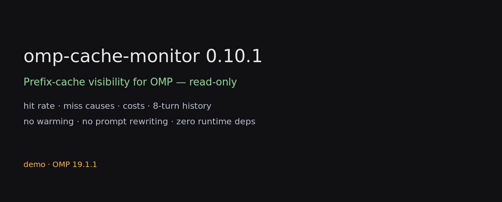
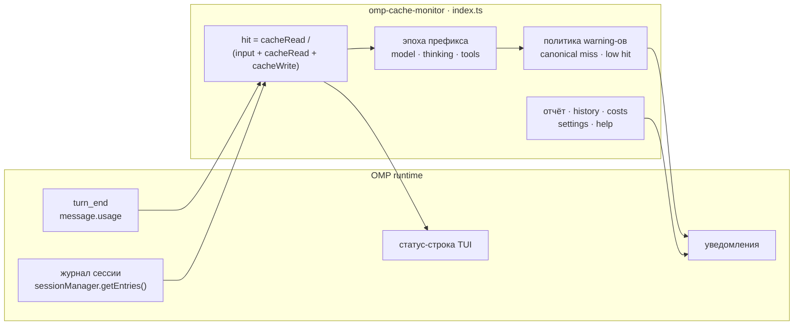
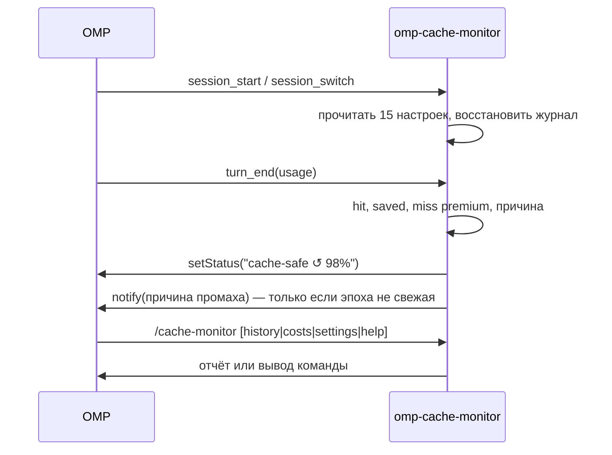
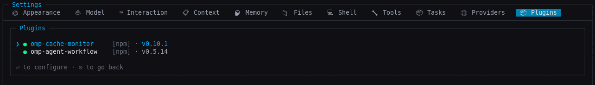
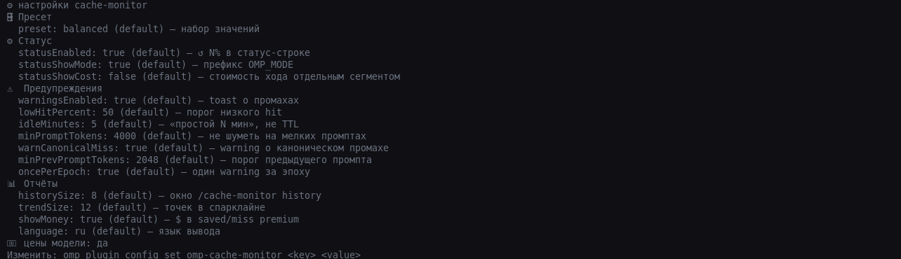

<p align="center">
  
</p>

<h1 align="center">omp-cache-monitor</h1>

<p align="center">
  <b>Read-only наблюдаемость префикс-кэша для OMP.</b><br>
  Hit rate, причины промахов, стоимость и история 8 ходов — без прогрева кэша,
  переписывания промптов и лишних токенов.
</p>

<p align="center">
  <code>0.10.1</code> · OMP 19.1.x · ноль runtime-зависимостей · один файл
  <code>index.ts</code> · 85 тестов
</p>

<p align="center">
  <a href="../README.md">English</a> · <a href="README.zh.md">中文</a> ·
  <b>Русский</b>
</p>

<p align="center">
  <a href="https://github.com/metapeka/omp-cache-monitor/releases/tag/v0.10.1"></a>
  
  
  
  
  
  
</p>

<details open>
<summary><b>📚 Содержание</b></summary>

- **Начать здесь** — [Демо](#демо) · [Почему omp-cache-monitor?](#почему-omp-cache-monitor) · [Коротко](#коротко) · [Быстрый старт](#быстрый-старт)
- **Понять** — [Как это работает](#как-это-работает) · [Формула](#формула) · [Saved и miss premium](#saved-и-miss-premium)
- **Использовать** — [Статус](#что-показывает) · [Предупреждения](#предупреждения) · [Настройки](#настройки) · [История](#история-последних-ходов) · [Стоимость](#разбивка-стоимости)
- **Эксплуатировать** — [Установка](#установка) · [Resume](#resume-компакция-и-cache-warming) · [Powerline](#powerline) · [Совместимость](#совместимость-и-конфликты-имён)
- **Сравнить** — [Конкуренты](#конкуренты) · [Исследование](research/cache-extensions.md) · [Release notes](release-notes-0.10.1.md)
- **Остальное** — [Карта docs](omp-docs-map.md) · [Upstream](upstream-settings-groups.md) · [Лицензия](#лицензия)

</details>

Расширение OMP: hit rate кэша префикса в статус-строке, предупреждения о промахах
и команда `/cache-monitor` (`history` — последние 8 ходов, `costs` — разбивка
стоимости сессии по типам записей журнала, `settings` — настройки плагина,
`help` — краткая справка).

Ничего не меняет в настройках и запросах: читает usage завершённого хода
(`turn_end.message.usage`) и журнал сессии (`sessionManager.getEntries()`),
публикует статус. Ошибка в обработчике не ломает ход.

## Демо



*Settings → Plugins, `/cache-monitor settings` и живой отчёт — записано в
OMP 19.1.1.*

## Почему omp-cache-monitor?

Отдельные цифры есть и у других cache-инструментов. **Фишка — комбинация:**
read-only наблюдатель, который говорит на языке режимов OMP, предупреждает
только когда промах настоящий, и переживает resume без выдуманных денег.

| ✅ | Что это значит |
|---|---|
| **Read-only by design** | Никакого прогрева кэша, переписывания промптов, прокси и скрытых вызовов модели. Только usage, за который OMP уже заплатил. |
| **Режим в статусе** | `cache-safe ↺ 98%`, `quality ↺ 74%`, `throughput ↺ 91%` — hit rate привязан к активному `OMP_MODE`, а не висит в вакууме. |
| **Одна команда, одна картина** | `/cache-monitor` собирает режим, модель, thinking, последний ход, суммы сессии, тренд, `saved` и `miss premium`; `history`, `costs`, `settings`, `help` закрывают остальное. |
| **Epoch-aware предупреждения** | Canonical miss или low hit — один раз за эпоху префикса, не на первом ходе и не после смены модели/thinking/tools/компакции/resume. Причина называется: `простой N мин` / `idle N min` или `перезапись префикса` / `prefix rewrite`. |
| **15 настроек, 4 пресета** | `balanced`, `quiet`, `verbose`, `custom`; у каждого ключа есть границы, defaults и английское описание в манифесте. `language: ru \| en` переводит runtime-вывод. |
| **Честный resume** | Суммы, тренд и история 8 ходов восстанавливаются из журнала; исторические цены не выдумываются. Деньги после resume — `≥` или `?`, а не фальшивое точное число. |
| **Ноль runtime-зависимостей** | Один `index.ts`, 85 детерминированных тестов, CI, `npm pack` = 4 файла. Без демона, базы и сети. |
| **Онбординг встроен** | Первый канонический промах добавляет одноразовую подсказку: где `/cache-monitor settings` и что значит `preset`. |

## Коротко

| | |
|---|---|
| **Статус-строка** | `cache-safe ↺ 98%` — ключ `cache-monitor`; опциональный сегмент `cache-monitor-cost` |
| **Предупреждения** | Canonical miss и low hit с причиной; раз за эпоху; порог промпта 4000 токенов |
| **Команды** | `/cache-monitor`, `history`/`hist`, `costs`/`cost`, `settings`/`setting`, `help`/`?` |
| **История** | Последние 8 завершённых ходов; восстанавливается после resume |
| **Стоимость** | Разбивка сессии по `dialog`/`compaction`/`branch`/`other`; `saved` и `miss premium` |
| **Настройки** | 15 ключей в `omp.settings`; пресеты `balanced`/`quiet`/`verbose`/`custom`; `language: ru \| en` |
| **Документация** | English, 中文, Русский; детали в `docs/` |
| **Релиз** | [v0.10.1](https://github.com/metapeka/omp-cache-monitor/releases/tag/v0.10.1) — GitHub release с tarball |
| **Установка** | `omp plugin install …` или `omp plugin link /path`; runtime-зависимостей нет |

## Как это работает





## Конкуренты

Ближайшие инструменты на **2026-11-23**. Это таблица позиционирования, а не
бенчмарк: возможности меняются, пустая клетка значит «не фокус», а не
«сломано». Источники и оговорки —
[`research/cache-extensions.md`](research/cache-extensions.md).

| Проект | Экосистема | Статус / UI | Команда-отчёт | Предупреждения | TTL / warming | Настройки | Runtime-зависимости |
|---|---|---|---|---|---|---|---|
| **omp-cache-monitor 0.10.1** | OMP | `cache-safe ↺ 98%`, с учётом режима | `/cache-monitor` + history/costs/settings/help | canonical miss + low hit, причина, раз за эпоху | нет — read-only | 15 ключей, 4 пресета, RU/EN | **0** |
| [omp-cache-meter](https://github.com/andreiverdes/agent-cache-meter) 0.1.1 | OMP | виджет над composer | `/cache`, панель, last 8 | warm/cold states | TTL + mirror warming | `/cache settings` | 0 |
| [omp-cache-hit-rate-extension](https://github.com/catitw/omp-cache-hit-rate-extension) | OMP | статус + тренд 10 ходов | команды нет | warm→cold alert | нет | нет | 0 (ручное копирование) |
| [omp-cache-control](https://github.com/ubranch/omp-cache-control) | OMP | только TTL | `/cache`, `/cache warm` | нет | TTL + платный warming | on/off | 1 |
| [omp-cache-optimizer](https://github.com/EF-FlowCode/omp-cache-optimizer) 2.1.0 | OMP | footer stats | `/cache-optimizer` + doctor | compat warnings | warming decision | doctor/config | 0 |
| [pi-cache-hit-monitor](https://pi.dev/packages/@narumitw/pi-cache-hit-monitor) 0.1.5 | PI | виджет + тренд 8 ходов | toggle-команда | epoch reset, без toast | нет | show/hide | 1 |

**Где мы сознательно не конкурируем:** TTL-countdown, warming, оптимизация
промптов, cross-session forensics и дашборды. Это отдельные продукты; на
`cline-pass` провайдер вообще не декларирует lifetime кэша, поэтому TTL был бы
догадкой. Плагин остаётся честным наблюдателем.

**Чего нет ни у кого в этой таблице в одной комбинации:** статус с учётом
режима `OMP_MODE`, одна команда с report/history/costs/settings, epoch-aware
предупреждения с названной причиной, resume без выдуманных цен, 15 ключей с
пресетами и zero-dependency один файл.

## Быстрый старт

```bash
# из публичного GitHub (shorthand)
omp plugin install github:metapeka/omp-cache-monitor

# или HTTPS git
omp plugin install git+https://github.com/metapeka/omp-cache-monitor.git

# или из локального чекаута — загружается на месте, без копирования
omp plugin link /path/to/omp-cache-monitor
```

Перезапустить `omp`, отправить промпт и выполнить:

```text
/cache-monitor
/cache-monitor history
/cache-monitor costs
/cache-monitor settings
```

Полная установка, статус-строка и Powerline — в разделе
[Установка](#установка) ниже.

## Что показывает

Статус-строка (только в TUI), ключ `cache-monitor`:

```
cache-safe ↺ 98%
```

Режим берётся из `OMP_MODE` (его выставляет `omp-mode`); без режима остаётся
`↺ 98%`, до первого хода — `↺ …`, при нулевом знаменателе — `↺ n/a` (без `%`).
При `statusShowCost: true` второй ключ `cache-monitor-cost` публикует
стоимость последнего хода как `$0.0027` (4 знака); hit-строка не меняется, а
cost-сегмент появляется только после завершённого хода.

Команда `/cache-monitor` печатает одной строкой режим, модель, thinking,
последний ход с `saved`, `miss premium`, тренд и итог сессии:

```
режим: cache-safe · test/model-a · thinking high · ход: ↺ 25% · in 3000 · cacheRead 1000 · cacheWrite 0 · $0.0200 · saved $0.0027 · miss premium: $0.0081 (3000 tok) · тренд: ▁▃ · сессия: $0.0700, ходов 2, ↺ 11.1%, saved $0.0027, miss premium $0.0081 (3000 tok)
```

| Поле | Что значит |
|---|---|
| `режим` | `OMP_MODE`; `без пресета` — запуск голым `omp` |
| модель, `thinking` | активная модель и live-уровень (`/effort`), при `undefined` — сконфигурированный из настроек; `?` — неизвестно |
| `ход: ↺ / in / cacheRead / cacheWrite / $ / saved` | последний запрос: hit, новый input, из кэша, записано в кэш, стоимость и `saved $X` — экономия на чтении кэша против полной цены input; `saved` печатается, только когда он больше нуля (нужны `cacheRead > 0`, известные цены и положительная разница `input − cacheRead`) |
| `miss premium: $X (N tok)` | пере-оплаченные токены после промаха: `N` заново оплачены по полной цене; деньги — только если у модели числовые `cost.input` и `cost.cacheRead`, иначе `miss premium: N tok`; печатается только когда `N > 0` |
| `тренд: ▁…█` | последние 12 хитов: `▁` — 0%, `█` — 100%, `·` — hit не определён (нулевой знаменатель) |
| `сессия: $ / ходов / ↺ / saved / miss premium` | накопленная стоимость, число ходов, hit, экономия и пере-оплата за сессию; `saved $X` — когда сумма > 0 и известна полностью, `saved ≥$X` — известна лишь часть (например, после resume); `miss premium $X (N tok)` печатается только при N > 0, `≥$X` — часть ходов без цен модели |

Если ходов ещё не было — `ход: нет данных`. При нулевом знаменателе hit
печатается как `↺ n/a`, без знака `%`. На `/new` тренд и суммы обнуляются; при
resume/reload/fork на `session_start` они восстанавливаются из журнала.
`/clear` и переходы по дереву сохраняют суммы.

## История последних ходов

`/cache-monitor history` (алиас `/cache-monitor hist`) печатает последние 8
завершённых ходов отдельным уведомлением, от старого к новому:

```
история (3/8):
1. ↺ 98% · prompt 5261 · saved $0.0139
2. ↺ 0% · prompt 4600 · miss premium $0.0124 (4600 tok) · перезапись префикса
3. ↺ 50% · prompt 4200 · saved $0.0057 · miss premium $0.0057 (2100 tok)
```

- `hit` и `prompt` — как в остальном отчёте; `saved` печатается только при
  `cacheRead > 0`: `saved $X` при известной цене и `saved ?`, когда после
  resume цена модели неизвестна.
- `miss premium` печатается только при `reBilled > 0`: `$X (N tok)` либо
  `? (N tok)` без цены.
- Причина (`простой N мин` / `перезапись префикса`) — только у канонического
  промаха; первый ход эпохи её не получает.
- Окно — 8 ходов по умолчанию (`historySize`); более старые вытесняются. Нет
  данных — `история: нет данных`.

`/new` очищает историю; resume/fork восстанавливают её из журнала (последние 8
assistant-сообщений), `/clear` и переходы по дереву сохраняют. У последней
восстановленной записи `miss premium` не показывается: граница resume в журнал
не пишется, поэтому сравнение с прошлым префиксом не доказано.

`/cache-monitor` без аргумента печатает прежний отчёт — история в него не
добавляется.

## Разбивка стоимости

`/cache-monitor costs` (алиас `/cache-monitor cost`) печатает, на что ушли
деньги сессии, одной notification:

```
стоимость сессии: $0.6369
диалог: $0.5425
recap: $0.0656
composer-prediction: $0.0191
job-widget: $0.0084
title: $0.0012
```

- Источник — только `usage.cost.total` записей журнала: assistant-сообщения
  (`диалог`), `compaction` (`компакция`), `branch_summary` (`ветка`), а также
  записи `usage`/`model_usage` по `kind`/`purpose` (префиксы `usage:` и
  `model_usage:` срезаются). Фоновые вызовы приходят только из журнала, live
  событий у них нет.
- OMP 19.1 пишет стоимость компакции и branch-summary как `model_usage` с
  purpose `compaction:<method>` / `branch-summary`; они сводятся в те же
  бакеты `компакция`/`ветка`, что и отдельные записи `compaction`/
  `branch_summary`.
- `диалог` всегда первым; остальные строки — по убыванию известной стоимости,
  затем по подписи. Нестроковый `kind`/`purpose` показывается как `прочее`.
- Заголовок — `стоимость сессии: $X`, где `X` — сумма известных стоимостей
  бакетов. Если хоть один бакет неполон, заголовок `≥$X`; бакет с полностью
  неизвестной ценой печатается как `label: ?`, частично известный — как
  `label: ≥$X`. Оценок нет.
- Команда пересобирает карту из журнала и идемпотентна: повторный вызов
  заменяет её, а не добавляет. При пустом журнале (новая сессия) показывается
  live-карта диалога; `/new` её очищает, пустая карта печатает
  `стоимость: нет данных`.
- Дефолтный `/cache-monitor` и `/cache-monitor history` не меняются и этих
  строк не содержат.

## Resume, компакция и cache warming

На `session_start` (startup, resume, reload, fork) расширение читает
`ctx.sessionManager.getEntries()` и восстанавливает суммы по
assistant-сообщениям, последние 12 хитов тренда, историю последних 8 ходов,
последний ход и пере-оплаченные токены. Границы эпохи из журнала
(`model_change`, `thinking_level_change`, `compaction`, `branch_summary`) не
дают сравнивать ходы через смену префикса.

Записи `usage` (любой `kind`) и `model_usage` (в OMP 19.1: cache warming,
title/composer и другие off-transcript вызовы), а также `compaction.usage` и
`branch_summary.usage` входят в стоимость сессии, но не в токены hit, ходы или
тренд: это фоновая работа, а не запросы диалога. Перед печатью
`/cache-monitor` стоимость пересчитывается по журналу, поэтому cache warming и
компакция учитываются, даже если для них не было live-события.

Первый ход после resume — новая эпоха: он не сравнивается с прошлым префиксом
и не предупреждает. `/new` по-прежнему обнуляет суммы.

Цены моделей в журнале не хранятся. `saved` восстановленных токенов кэша не
оценивается: в сессии он растёт только по live-ходам, а если в журнале был
`cacheRead > 0`, сумма помечается `≥` (`saved ≥$X`). Пере-оплаченные токены
после resume восстанавливаются, но деньги за них тоже не выдумываются:
`miss premium` печатается в токенах, а при частично известной сумме остаётся
маркер `≥`. Пере-оплата самого последнего хода перед resume консервативно не
восстанавливается: граница resume в журнал не пишется, поэтому сравнение с
прошлым префиксом не доказано. Более ранние границы resume тоже не отмечены,
поэтому пере-оплата между такими ходами может остаться приблизительной.

## Формула

```
hit = cacheRead / (input + cacheRead + cacheWrite)
```

`cacheWrite` входит в знаменатель: запись в кэш тоже оплачивается. Если
знаменатель равен нулю, hit не определён — `n/a`.

## Saved и miss premium

Обе метрики считаются на токен, цены — `$/1M` из `model.cost`:

```
saved        = cacheRead × (inputPrice − cacheReadPrice)
miss premium = reBilled  × (inputPrice − cacheReadPrice)
reBilled     = max(0, min(prevPrompt, prompt) − cacheRead)
```

`inputPrice − cacheReadPrice` — разница между полной ценой нового input и ценой
чтения кэша, не меньше нуля. `saved` — сколько сэкономлено на чтении кэша
против полной цены; `miss premium` — сколько токенов после промаха заново
оплачено по полной цене. Если у модели нет числовых `cost.input` и
`cost.cacheRead`, `saved` не печатается, а `miss premium` остаётся в токенах.
После resume цены прошлых ходов неизвестны, поэтому `saved` считает только
live-часть и показывает `≥`.

## Предупреждения

Сравнение epoch-aware: база для сравнения сбрасывается на компакции, смене
модели, thinking или набора инструментов, поэтому законно холодный ход после
такого события не считается промахом посреди сессии.

1. **Канонический промах** — на предыдущем ходе промпт был ≥
   `minPrevPromptTokens` токенов (по умолчанию 2048), а на
   текущем `cacheRead = 0` и `cacheWrite > 0`: префикс перезаписан целиком или
   кэш истёк. Причина считается per-turn: `простой N мин`
   (`idle N min` при `language: en`), если между
   завершёнными ходами прошло ≥ 5 минут по `message.timestamp`, иначе
   `перезапись префикса` (`prefix rewrite`). Порог 5 минут — эмпирическая
   эвристика, **не**
   объявленный TTL провайдера: `cline-pass` lifetime не декларирует. Простой
   через границу эпохи (смена модели/thinking/tools, компакция, resume) новому
   префиксу не приписывается; без timestamp причина — `перезапись префикса`
   (`prefix rewrite`), а ход без timestamp разрывает цепочку простоя для
   следующего хода.
2. **Низкий hit** — меньше 50% на ходе не первом (первый ход холодный по
   определению).

Предупреждение — сигнал проверить, что менялось за 1–2 хода до него, а не ошибка
само по себе.

Первый канонический промах за процесс добавляет одноразовую подсказку: где
открыть `/cache-monitor settings` и что значит `preset`. Повторно она не
появляется ни в следующих эпохах, ни при смене сессии в том же процессе.

`warnCanonicalMiss: false` отключает только toast о каноническом промахе
(low hit продолжает работать); `minPrevPromptTokens` двигает порог предыдущего
промпта; `oncePerEpoch: false` предупреждает на каждом подходящем ходе, а не
один раз за эпоху.

## Настройки

Схема лежит в `package.json` → `omp.settings`. OMP показывает её в
**Settings → Plugins → omp-cache-monitor** и в CLI:

```bash
omp plugin config list omp-cache-monitor
omp plugin config set omp-cache-monitor lowHitPercent 30
omp plugin config set omp-cache-monitor statusEnabled false
omp plugin config set omp-cache-monitor showMoney false
```

Settings → Plugins в OMP 19.1.1:



Те же значения из `/cache-monitor settings`:



OMP рисует плагинные настройки **плоским списком**: `description` выбранной
строки показывается в подвале, а групп, заголовков и иконок в схеме плагина
нет (они есть только у core settings). Поэтому группы кодируются порядком
ключей и префиксом `Preset ·` / `Status ·` / `Warnings ·` / `Reports ·` в
описании, а `/cache-monitor settings` повторяет те же заголовки. Детали и
upstream-предложение `group`/`icon` — [`ui-settings.md`](ui-settings.md).
Карта документации OMP — [`omp-docs-map.md`](omp-docs-map.md).

Настройки читаются на старте/переключении сессии и перед каждой командой,
поэтому изменение из UI применяется со следующего хода после любой команды
`/cache-monitor` (или в новой сессии).
`/cache-monitor settings` (алиас `setting`) перечитывает их сразу и печатает
текущие значения, пометку `(changed)`/`(default)` и наличие цен модели:

```
⚙ настройки cache-monitor
🎛 Пресет
  preset: balanced (default) — набор значений
⚙ Статус
  statusEnabled: true (default) — ↺ N% в статус-строке
  statusShowMode: true (default) — префикс OMP_MODE
  statusShowCost: false (default) — стоимость хода отдельным сегментом
⚠️ Предупреждения
  warningsEnabled: true (default) — toast о промахах
  lowHitPercent: 50 (default) — порог низкого hit
  idleMinutes: 5 (default) — «простой N мин», не TTL
  minPromptTokens: 4000 (default) — не шуметь на мелких промптах
  warnCanonicalMiss: true (default) — warning о каноническом промахе
  minPrevPromptTokens: 2048 (default) — порог предыдущего промпта
  oncePerEpoch: true (default) — один warning за эпоху
📊 Отчёты
  historySize: 8 (default) — окно /cache-monitor history
  trendSize: 12 (default) — точек в спарклайне
  showMoney: true (default) — $ в saved/miss premium
  language: ru (default) — язык вывода
💵 цены модели: да
Изменить: omp plugin config set omp-cache-monitor <key> <value>
```

`preset` — набор значений остальных ключей; явно заданный ключ сильнее
пресета, а `custom` не применяет пресетных значений. `balanced` повторяет
defaults, `quiet` выключает режим в статусе, warning-и и cost-сегмент,
`verbose` повышает плотность сигналов (lowHit 60, idle 3, minPrompt 2000,
history 12, trend 20, cost on, minPrev 1024, warning на каждом ходе).
Advanced-ключи (`warnCanonicalMiss`, `minPrevPromptTokens`, `oncePerEpoch`,
`trendSize`, `statusShowCost`) настраивают отдельные поведения сверху.
`preset` печатает только `settings`; отчёт, history и costs его не содержат.

| Ключ | Default | Диапазон | Что меняет |
|---|---|---|---|
| `preset` | `balanced` | `balanced` / `quiet` / `verbose` / `custom` | Набор значений остальных ключей. Явно заданный ключ сильнее пресета; `custom` не применяет пресетных значений. `language` не меняет. |
| `statusEnabled` | `true` | boolean | Публиковать hit rate в статус-строке. `false` — `setStatus` не вызывается, старый статус не чистится. |
| `statusShowMode` | `true` | boolean | Префикс `OMP_MODE` у статуса (`cache-safe ↺ 75%`). `false` — только `↺ 75%`. |
| `statusShowCost` | `false` | boolean | Публиковать стоимость последнего хода отдельным статус-ключом `cache-monitor-cost` (`$0.0027`, 4 знака). Hit-строка `cache-monitor` не меняется. |
| `warningsEnabled` | `true` | boolean | Предупреждения о каноническом промахе и низком hit. `false` — ни одного warning. |
| `lowHitPercent` | `50` | 1–100 | Warning, когда hit ниже этого процента. |
| `idleMinutes` | `5` | 1–240 | Разрыв, который причина промаха называет простоем (`простой N мин` / `idle N min`). Эмпирика, **не** TTL провайдера. |
| `minPromptTokens` | `4000` | 0–1 000 000 | Не предупреждать на меньших промптах; тот же порог в причине и restore. |
| `warnCanonicalMiss` | `true` | boolean | Toast о каноническом промахе. `false` отключает только его, low hit продолжает работать. |
| `minPrevPromptTokens` | `2048` | 0–1 000 000 | Минимальный prompt предыдущего хода для сравнения; заменяет прежнюю константу `MIN_PREV_PROMPT`. |
| `oncePerEpoch` | `true` | boolean | `true` — один warning каждого типа за эпоху; `false` — на каждом подходящем ходе. |
| `historySize` | `8` | 1–50 | Окно `/cache-monitor history` (live и после resume) и делитель `история (N/M):` / `history (N/M):`. |
| `trendSize` | `12` | 1–50 | Длина спарклайна; live-окно и restore из журнала используют одно значение. |
| `showMoney` | `true` | boolean | `saved` и деньги `miss premium` в отчёте и history. При `false` остаются токены (`miss premium: 3000 tok` / `miss premium 3000 tok`), а `/cache-monitor costs` деньги показывает. |
| `language` | `ru` | `ru` / `en` | Язык пользовательского вывода: подписи отчёта, заголовки и причины history, подписи costs, `settings`, `help` и warning-и. `ru` сохраняет прежний вывод байт-в-байт. Описания `omp.settings` в манифесте остаются английскими при любом языке. |

Невалидные значения откатываются к значению пресета (без пресета — к
default); числа округляются и зажимаются (`lowHitPercent: 500` → `100`,
`idleMinutes: 0` → `1`, `historySize: 3.6` → `4`, `trendSize: 999` → `50`,
`minPrevPromptTokens: -5` → `0`). Невалидный `language` откатывается к `ru` и
пресетом не меняется. Defaults воспроизводят вывод до 0.8.0 побайтово, кроме
новых строк в `settings`. Подробности: [`ui-settings.md`](ui-settings.md).

`language: en` переводит все пользовательские строки — подписи отчёта и
history, причины промахов, подписи costs, `settings`, `help` и warning-и —
при том же формате метрик, токенов и денег. Описания `omp.settings` в
манифесте остаются английскими независимо от `language`.

```
omp plugin config set omp-cache-monitor language en
```

```
cache-monitor — prefix-cache hit rate.
↺ N% — share of the prompt read from cache; higher is cheaper. ↺ … before the first turn, n/a with no denominator.
Miss — cacheRead 0; cause is in warnings and history, re-billing in the report and history.
/cache-monitor — report; history — recent turns; costs — cost breakdown.
settings — current settings; help — this help.
Settings: Settings → Plugins → omp-cache-monitor or omp plugin config set omp-cache-monitor <key> <value>.
Applied to new sessions; settings re-reads immediately.
Docs: README.md, docs/ui-settings.md, docs/omp-docs-map.md.
```

`/cache-monitor help` (алиас `?`) печатает справку из 8 строк: что значит
`↺` («чем выше, тем дешевле»), что промах — это `cacheRead 0`, список
подкоманд (`отчёт`, `history`, `costs`, `settings`, `help`), где менять
настройки, и ссылки на `README.md`, `docs/ui-settings.md`,
`docs/omp-docs-map.md`. Обещаний TTL нет.

## Установка

npm-пакет не опубликован. Репозиторий публичный; OMP 19.1:

```bash
# публичный GitHub shorthand
omp plugin install github:metapeka/omp-cache-monitor

# HTTPS git (SSH-ключ не нужен)
omp plugin install git+https://github.com/metapeka/omp-cache-monitor.git

# SSH тоже работает, если ключ настроен
omp plugin install git+ssh://git@github.com/metapeka/omp-cache-monitor.git

# локальный чекаут: загружается из каталога без копирования
omp plugin link /path/to/omp-cache-monitor

# эквивалент (алиас plugin link)
omp install /path/to/omp-cache-monitor
```

Альтернатива — скопировать единственный файл расширения:

```bash
cp /path/to/omp-cache-monitor/index.ts ~/.omp/agent/extensions/cache-monitor.ts
```

Ставить нужно одним способом: `omp plugin link` **или** копия файла. Одновременно
не надо — расширение загрузится дважды. После установки перезапустить `omp`.

### Сегмент статус-строки

Сегмент `status` ставит hook-статус в общий ряд статус-строки. Без него при
`statusLine.showHookStatus: true` (дефолт) статус всё равно показывается, но
отдельным элементом. В `~/.omp/agent/config.yml`:

```yaml
statusLine:
  preset: custom
  leftSegments: ["vim", "model", "mode", "path", "git", "pr"]
  rightSegments: ["session_name", "token_total", "cost", "context_pct", "status"]
```

### Powerline

Тот же ключ `cache-monitor` можно показать как нативный сегмент OMP с
разделителем `powerline-thin` или вынести в `pi-powerline-footer` через
`customItems` (`statusKey: "cache-monitor"`). Дополнительный код не нужен.
Конфигурация обоих вариантов, включая settings-файл внешнего плагина, —
в [`powerline.md`](powerline.md).

## Совместимость и конфликты имён

- OMP 19.1.x (19.1.0–19.1.1); проверено на маршруте `cline-pass`.
- Команда называется `/cache-monitor`, потому что `/cache` уже занимает
  `ubranch/omp-cache-control`. Оба расширения можно держать включёнными: они
  регистрируют разные команды и разные ключи статуса.
- Статус публикуется только в TUI; в `--mode json`/`--print` вызовы UI
  безвредны и ничего не показывают.

## Связанные документы

- [English README](../README.md) · [中文 README](README.zh.md)
- Шпаргалка по режимам, `/cache-monitor` и диагностике:
  https://metapeka.github.io/docs-omp-debian-availability/wiki/guide.html
- Пресеты `cache-safe`/`quality`/`throughput`, wrapper `omp-mode` и история
  решений — репозиторий https://github.com/metapeka/docs-omp-debian-availability
  (`presets/`, `docs/plan-cache-modes.md`).
- Источники по конкурентам — [`research/cache-extensions.md`](research/cache-extensions.md).
- Release notes — [`release-notes-0.10.1.md`](release-notes-0.10.1.md).

## Релиз

- [v0.10.1](https://github.com/metapeka/omp-cache-monitor/releases/tag/v0.10.1) —
  пресеты, онбординг, документация на трёх языках, demo-GIF.

## Лицензия

MIT, см. `LICENSE`.
