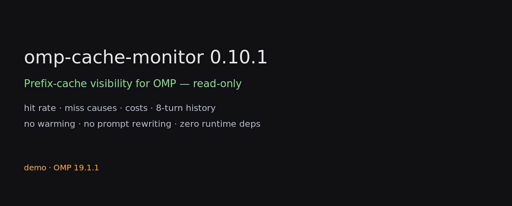
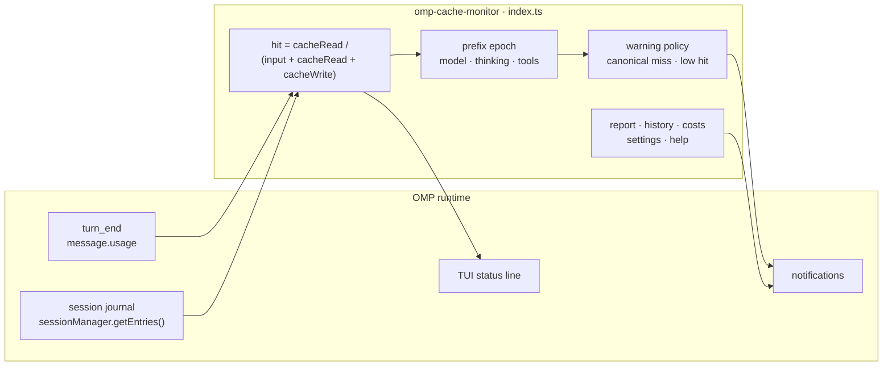
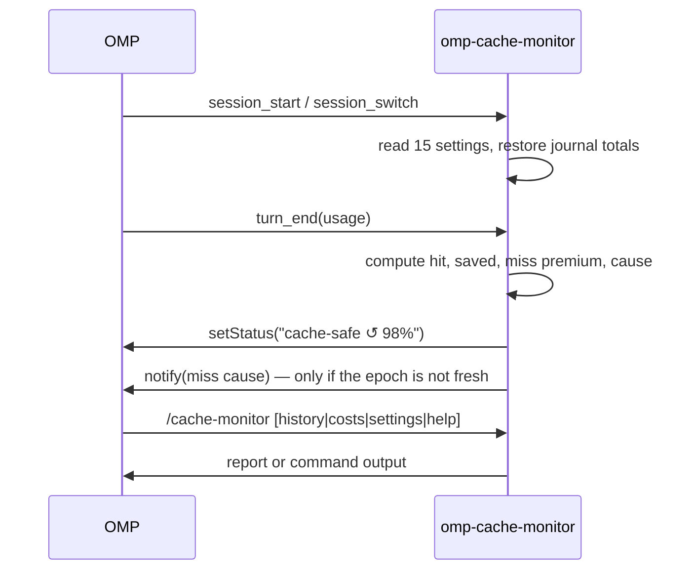
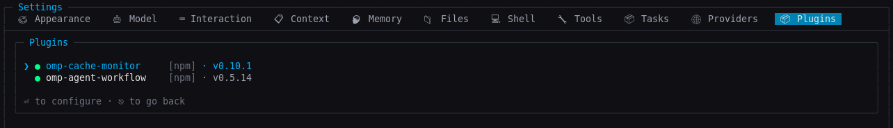
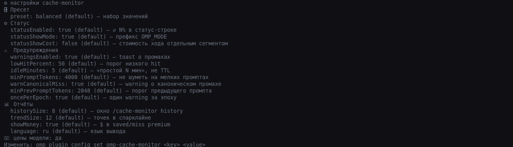

<p align="center">
  
</p>

<h1 align="center">omp-cache-monitor</h1>

<p align="center">
  <b>面向 OMP 的前缀缓存只读可观测性。</b><br>
  命中率、未命中原因、成本，以及最近 8 个回合的历史——不预热缓存、不改写提示词，
  也不多花一个 token。
</p>

<p align="center">
  <code>0.11.0</code> · OMP 19.1.x · 零运行时依赖 · 单个扩展文件
  <code>index.ts</code> · CLI <code>costs --json</code> · 104 项测试
</p>

<p align="center">
  <a href="../README.md">English</a> · <b>中文</b> ·
  <a href="README.ru.md">Русский</a>
</p>

<p align="center">
  <a href="https://github.com/metapeka/omp-cache-monitor/releases/tag/v0.10.1"></a>
  
  
  
  
  
  
</p>

<details open>
<summary><b>📚 目录</b></summary>

- **从这里开始** — [演示](#演示) · [为什么选择 omp-cache-monitor？](#为什么选择-omp-cache-monitor) · [一览](#一览) · [快速开始](#快速开始)
- **理解它** — [工作原理](#工作原理) · [计算公式](#计算公式) · [节省金额与未命中溢价](#节省金额与未命中溢价)
- **使用它** — [状态栏](#显示内容) · [警告](#警告) · [设置](#设置) · [历史](#回合历史) · [成本](#成本明细) · [CLI costs JSON](#cli-costs---json)
- **运维它** — [安装](#安装) · [恢复](#恢复压缩与缓存预热) · [Powerline](#powerline) · [兼容性](#兼容性与名称冲突)
- **比较** — [竞品对比](#竞品对比) · [研究](research/cache-extensions.md) · [发布说明](release-notes-0.10.1.md)
- **其他** — [文档地图](omp-docs-map.md) · [上游提案](upstream-settings-groups.md) · [许可证](#许可证)

</details>

OMP 扩展：在状态栏显示前缀缓存命中率、未命中警告，以及 `/cache-monitor`
命令（`history` 显示最近 8 个回合，`costs` 按会话日志条目类型拆分会话成本，
`settings` 显示插件设置，`help` 打印简要参考）。

它不会改动设置或请求：只读取已完成回合的用量
（`turn_end.message.usage`）和会话日志
（`sessionManager.getEntries()`），然后发布状态。处理函数内部出错也不会中断
回合。

## 演示



*设置 → 插件、`/cache-monitor settings`，以及一份包含真实回合数据的报告——
录制于 OMP 19.1.1。*

## 为什么选择 omp-cache-monitor？

这些数字单独来看，其他缓存工具也有。**组合起来才是特色：** 一个只读观察者，
与 OMP 模式使用同一套术语，只在未命中确实发生时发出警告，并且在恢复会话后
不会凭空编造金额。

| ✅ | 含义 |
|---|---|
| **设计上只读** | 不预热缓存、不改写提示词、不使用代理、不发起隐藏的模型调用。它只观察 OMP 已经付过费的用量。 |
| **感知 OMP 模式的状态** | `cache-safe ↺ 98%`、`quality ↺ 74%`、`throughput ↺ 91%`——命中率与当前生效的 `OMP_MODE` 绑定，而不是孤立显示。 |
| **一个命令，一套心智模型** | `/cache-monitor` 汇总模式、模型、思考等级、上一回合、会话总计、趋势、`saved` 与 `miss premium`；`history`、`costs`、`settings`、`help` 覆盖其余部分。 |
| **按前缀 epoch 判断的警告** | canonical miss 或低命中，每个前缀 epoch 只提示一次；首个回合以及模型/思考/工具/压缩/恢复变更后会跳过。原因会被明确命名：`простой N мин` / `idle N min` 或 `перезапись префикса` / `prefix rewrite`。 |
| **15 项设置，4 个预设** | `balanced`、`quiet`、`verbose`、`custom`；每个键都有取值范围、默认值和英文清单描述。`language: ru \| en` 用于本地化运行时输出。 |
| **诚实的恢复** | 总计、趋势和 8 回合的历史都从会话日志重建；不会虚构历史价格。恢复后的金额显示为 `≥` 或 `?`，绝不会是伪造的精确数字。 |
| **零运行时依赖** | 一个 `index.ts` 扩展，加上 `bin/` + `lib/` 的 CLI，104 项确定性测试、CI，`npm pack` = 6 个文件。没有守护进程、没有数据库、没有网络。 |
| **内置上手引导** | 第一次 canonical miss 时会附加一次性提示：`/cache-monitor settings` 在哪里，以及 `preset` 是什么意思。 |

## 一览

| | |
|---|---|
| **状态栏** | `cache-safe ↺ 98%` — 键 `cache-monitor`；可选 `cache-monitor-cost` 片段 |
| **警告** | canonical miss 与低命中，附带原因；每个前缀 epoch 一次；提示词下限 4000 token |
| **命令** | `/cache-monitor`、`history`/`hist`、`costs`/`cost`、`settings`/`setting`、`help`/`?` |
| **历史** | 最近 8 个已完成回合，恢复会话后重建 |
| **成本** | 按 `dialog`/`compaction`/`branch`/`other` 拆分会话成本；`saved` 与 `miss premium` |
| **CLI** | `omp-cache-monitor costs --json` — 供脚本使用的 schemaVersion 1 会话成本 |
| **设置** | `omp.settings` 中的 15 个键；预设 `balanced`/`quiet`/`verbose`/`custom`；`language: ru \| en` |
| **文档** | English、中文、Русский；深入说明在 `docs/` |
| **发布** | [v0.10.1](https://github.com/metapeka/omp-cache-monitor/releases/tag/v0.10.1)——私有 GitHub release，附 tarball |
| **安装** | `omp plugin install …` 或 `omp plugin link /path`；无运行时依赖 |

## 工作原理





## 竞品对比

截至 **2026-11-23** 的相近工具。这是一张定位表，不是基准测试：功能会变化，
空白单元格表示“不是重点”，而非“坏了”。来源与注意事项：
[`docs/research/cache-extensions.md`](research/cache-extensions.md)。

| 项目 | 生态 | 状态 / 界面 | 命令报告 | 警告 | TTL / 预热 | 设置 | 运行时依赖 |
|---|---|---|---|---|---|---|---|
| **omp-cache-monitor 0.10.1** | OMP | `cache-safe ↺ 98%`，感知模式 | `/cache-monitor` + history/costs/settings/help | canonical miss + 低命中，附原因，每个前缀 epoch 一次 | 无——只读 | 15 键，4 预设，RU/EN | **0** |
| [omp-cache-meter](https://github.com/andreiverdes/agent-cache-meter) 0.1.1 | OMP | 输入框上方的小组件 | `/cache`、面板、最近 8 条 | 暖/冷状态 | TTL + 镜像预热 | `/cache settings` | 0 |
| [omp-cache-hit-rate-extension](https://github.com/catitw/omp-cache-hit-rate-extension) | OMP | 状态栏 + 10 回合趋势 | 无命令 | 暖→冷告警 | 无 | 无 | 0（手动复制） |
| [omp-cache-control](https://github.com/ubranch/omp-cache-control) | OMP | 仅 TTL | `/cache`、`/cache warm` | 无 | TTL + 付费预热 | 开/关 | 1 |
| [omp-cache-optimizer](https://github.com/EF-FlowCode/omp-cache-optimizer) 2.1.0 | OMP | 页脚统计 | `/cache-optimizer` + doctor | 兼容性警告 | 预热决策 | doctor/config | 0 |
| [pi-cache-hit-monitor](https://pi.dev/packages/@narumitw/pi-cache-hit-monitor) 0.1.5 | PI | 小组件 + 8 回合趋势 | 切换命令 | epoch 重置，无弹出提示 | 无 | 显示/隐藏 | 1 |

**我们刻意不参与竞争的范围：** TTL 倒计时、预热、提示词优化、跨会话取证和
仪表盘。那些是另外的产品；在 `cline-pass` 上，提供方甚至没有声明缓存生命周期，
因此 TTL 只能靠猜。本插件始终是可信的观察者。

**本表中其他工具都未同时具备的组合：** 与 `OMP_MODE` 联动的状态、一个命令
涵盖报告/历史/成本/设置、附带明确原因且按 epoch 判断的警告、恢复会话时不虚构
价格、15 键预设，以及零依赖的单文件。

## 快速开始

```bash
# 从公开 GitHub 安装（shorthand）
omp plugin install github:metapeka/omp-cache-monitor

# 或 HTTPS git
omp plugin install git+https://github.com/metapeka/omp-cache-monitor.git

# 或从本地检出处加载，无需复制
omp plugin link /path/to/omp-cache-monitor
```

然后重启 `omp`，发送一条提示词，并运行：

```text
/cache-monitor
/cache-monitor history
/cache-monitor costs
/cache-monitor settings
```

完整的安装选项、状态栏接线和 Powerline 见下文[安装](#安装)。

## 显示内容

状态栏（仅 TUI），键 `cache-monitor`：

```
cache-safe ↺ 98%
```

模式来自 `OMP_MODE`（由 `omp-mode` 设置）；没有模式时显示 `↺ 98%`，首个回合
之前显示 `↺ …`，分母为零时显示 `↺ n/a`（不带 `%`）。启用
`statusShowCost: true` 后，第二个键 `cache-monitor-cost` 会把上一回合成本
发布为 `$0.0027`（4 位小数）；命中行保持不变，成本片段仅在完成一个回合后
出现。

`/cache-monitor` 打印一行内容，包含模式、模型、思考等级、带 `saved` 和
`miss premium` 的上一回合、趋势以及会话总计：

```
режим: cache-safe · test/model-a · thinking high · ход: ↺ 25% · in 3000 · cacheRead 1000 · cacheWrite 0 · $0.0200 · saved $0.0027 · miss premium: $0.0081 (3000 tok) · тренд: ▁▃ · сессия: $0.0700, ходов 2, ↺ 11.1%, saved $0.0027, miss premium $0.0081 (3000 tok)
```

| 字段 | 含义 |
|---|---|
| _(标签)_ | 命令输出保持俄语（`режим`、`ход`、`сессия`、`тренд`）；本表解释各字段 |
| `режим` | `OMP_MODE`；`без пресета` 表示未使用预设、直接启动 `omp` |
| 模型、`thinking` | 当前生效的模型与实时等级（`/effort`）；为 `undefined` 时使用配置值；`?` 表示未知 |
| `ход: ↺ / in / cacheRead / cacheWrite / $ / saved` | 上一次请求：命中、新输入、缓存读取、缓存写入、成本，以及 `saved $X`——相比完整输入价格，缓存读取节省的金额；仅在为正时打印（`cacheRead > 0`、价格已知、`input − cacheRead` 差值为正） |
| `miss premium: $X (N tok)` | 未命中后重新计费的 token：`N` 个 token 按完整价格计费；仅当模型有数值型 `cost.input` 和 `cost.cacheRead` 时才显示金额，否则显示 `miss premium: N tok`；仅在 `N > 0` 时打印 |
| `тренд: ▁…█` | 最近 12 次命中：`▁` = 0%，`█` = 100%，`·` = 命中率未定义（分母为零） |
| `сессия: $ / ходов / ↺ / saved / miss premium` | 会话成本、回合数、命中率、节省金额和重新计费的 token；总和完整已知时显示 `saved $X`，仅为下界时显示 `saved ≥$X`（例如恢复会话后）；仅在 `N > 0` 时显示 `miss premium $X (N tok)`，部分回合缺少模型价格时显示 `≥$X` |

首个回合之前，该字段显示 `ход: нет данных`。分母为零时命中率为 `↺ n/a`，
不带 `%`。`/new` 会重置趋势和总计；恢复/重载/fork 会在 `session_start`
时从会话日志重建它们。`/clear` 和树形导航会保留总计。

## 回合历史

`/cache-monitor history`（别名 `/cache-monitor hist`）以单独通知的形式打印
最近 8 个已完成回合，最早的在前：

```
история (3/8):
1. ↺ 98% · prompt 5261 · saved $0.0139
2. ↺ 0% · prompt 4600 · miss premium $0.0124 (4600 tok) · перезапись префикса
3. ↺ 50% · prompt 4200 · saved $0.0057 · miss premium $0.0057 (2100 tok)
```

- `hit` 和 `prompt` 的含义与报告其余部分相同；`saved` 仅在
  `cacheRead > 0` 时打印：价格已知时显示 `saved $X`，恢复会话后模型价格
  未知时显示 `saved ?`。
- `miss premium` 仅在 `reBilled > 0` 时打印：`$X (N tok)`，无价格时为
  `? (N tok)`。
- 原因（`простой N мин` / `перезапись префикса`）只附加到 canonical miss；epoch 的
  第一个回合永远不会附带。
- 默认窗口为 8 个回合（`historySize`）；更早的会被挤出。没有数据时打印
  `история: нет данных`。

`/new` 会清空历史；恢复/fork 会从会话日志重建（最近 8 条助手消息）；
`/clear` 和树形导航会保留它。最后一条恢复的记录永远不会显示
`miss premium`：恢复边界没有写入会话日志，因此无法证明与上一前缀的对比。

不带参数的 `/cache-monitor` 打印上一份报告；历史不会附加到其中。

## 成本明细

`/cache-monitor costs`（别名 `/cache-monitor cost`）以一条通知的形式打印
会话费用实际去了哪里：

```
стоимость сессии: $0.6369
диалог: $0.5425
recap: $0.0656
composer-prediction: $0.0191
job-widget: $0.0084
title: $0.0012
```

- 来源仅为会话日志中的 `usage.cost.total` 值：助手消息（`диалог`）、
  `compaction`（`компакция`）、`branch_summary`（`ветка`），以及按
  `kind`/`purpose` 归类的 `usage`/`model_usage` 条目（会去掉 `usage:` 和
  `model_usage:` 前缀）。后台调用绝不会来自实时事件，只会来自会话日志。
- OMP 19.1 将会话压缩和分支摘要的支出记录为 `model_usage`，其 purpose 为
  `compaction:<method>` / `branch-summary`；它们会归入 `компакция` /
  `ветка` 分组，与会话日志中的 `compaction` / `branch_summary` 条目相同。
- `диалог` 始终排在第一位；其他分组按已知成本降序排列，然后按标签排序。
  `kind`/`purpose` 不是字符串时显示为 `прочее`。
- 标题为 `стоимость сессии: $X`，其中 `X` 是各已知分组成本之和。如果任一
  分组价格未知，标题为 `≥$X`；价格完全未知的分组打印 `label: ?`，仅部分
  已知的分组打印 `label: ≥$X`。不会估算任何价格。
- 该命令会从会话日志重新计算，因此是幂等的：重复调用会替换映射，而不是
  累加。会话日志为空时（全新会话、无条目），它会报告当前对话映射；`/new`
  会清空它，空映射会打印 `стоимость: нет данных`。
- 默认的 `/cache-monitor` 和 `/cache-monitor history` 输出不会改变，也永远
  不会包含这些行。

## CLI: `costs --json`

`omp-cache-monitor costs --json` 将一个会话输出为单个 JSON 文档，供脚本、hub
和其他 agent 使用。命令是只读的：只解析 session JSONL，不访问网络，也不写
文件。扩展与 `/cache-monitor` 不受影响。

```bash
omp-cache-monitor costs --json [--session FILE] [--since ISO8601]
```

```bash
npm link   # 在检出目录中把 omp-cache-monitor 放进 PATH
omp-cache-monitor costs --json --session ~/.omp/agent/sessions/<项目>/<id>.jsonl

# 不 link 时（普通 Node；CLI 以 .mjs 发布，无需 type stripping）
node bin/omp-cache-monitor.mjs costs --json
```

退出码：`0` 表示有报告，`1` 表示没有会话或文件不可读，`2` 表示参数错误。
`--json` 是契约；不加时打印简短的人类可读摘要。缺失或不可读的会话是 exit
`1` 且没有 JSON；空但有效的文件是 exit `0` 和空报告。

- 没有 `--session` 时，取 `OMP_SESSIONS_DIR`（或 `~/.omp/agent/sessions`）下
  按 mtime 最新的 `*.jsonl`：目录本身的文件和一层项目子目录；忽略
  `changes.jsonl` 和更深的目录。
- 来源只有 `message.assistant.usage`；`model_usage`、`usage`、`compaction` 和
  `branch_summary` 是服务调用，不计入。
- `hitPercent = cacheRead / (input + cacheRead)`，精度 0.1；没有分母时为
  `null`。`cacheWrite` 不进分母——这一点有意区别于扩展的命中率。
- `costUsd` 是提供方的 `usage.cost.total`；缺失时是 `null` 加一条 note，绝不为
  0。`totals.costUsd` 汇总已知价格，只有当所有回合都没有价格时才为 `null`。
- `--since` 保留 `at >= since` 的回合；totals 和 models 按过滤后的回合计算，
  `session` 不变。秒可省略，时区不可省略：`2026-11-26T12:00Z` 有效，没有时区
  的时间戳会 exit `2`。
- `notes` 是确定性的：`cost missing`、`timestamp invalid or missing: turn
  skipped`、`cold prefix`、`cold prefix after model switch`、`cacheWrite > 0`；
  连续的相同 note 会合并。
- 未知字段是增量的：读取方忽略不使用的字段。
- `schemaVersion: 1`；破坏性变更会提升 schema 版本并写入 CHANGELOG。

截断的响应（数字已简写）：

```json
{
  "schemaVersion": 1,
  "session": "/home/me/.omp/agent/sessions/-p/2026-11-26T22-05-34Z_id.jsonl",
  "totals": {
    "costUsd": 0.0482,
    "inputTokens": 58055,
    "cacheReadTokens": 1157632,
    "cacheWriteTokens": 0,
    "outputTokens": 19825,
    "reasoningTokens": 11849
  },
  "turns": [
    {
      "at": "2026-11-26T22:06:00.918Z",
      "model": "deepseek-v4.1-flash-1017",
      "costUsd": 0.0056,
      "inputTokens": 17513,
      "cacheReadTokens": 0,
      "cacheWriteTokens": 0,
      "outputTokens": 250,
      "reasoningTokens": 47,
      "hitPercent": 0
    }
  ],
  "models": [
    { "model": "deepseek-v4.1-flash-1017", "turns": 21, "costUsd": 0.0482, "hitPercent": 95.2 }
  ],
  "notes": []
}
```

## 恢复、压缩与缓存预热

在 `session_start`（启动、恢复、重载、fork）时，扩展会读取
`ctx.sessionManager.getEntries()`，并从助手消息恢复总计，同时恢复最近 12 次
命中趋势、最近 8 个回合的历史、上一回合以及重新计费的 token。会话日志中记录的
epoch 边界（`model_change`、`thinking_level_change`、`compaction`、
`branch_summary`）可以防止在跨前缀变更时比较回合。

`usage` 条目（任意 `kind`）和 `model_usage`（OMP 19.1：缓存预热、标题/
输入框及其他不进入对话记录的调用），以及 `compaction.usage` 和
`branch_summary.usage`，会计入会话成本，但不计入命中的 token、回合数或
趋势：那是后台工作，不是对话请求。打印之前，`/cache-monitor` 会从会话日志
重新计算成本，因此即使没有实时事件，缓存预热和压缩也会被计入。

恢复后的第一个回合是一个新epoch：它不会与上一前缀比较，也不会发出警告。
`/new` 仍会重置总计。

模型价格不会存入会话日志。恢复的缓存 token 对应的 `saved` 不会被估算：
它只随实时回合增长；如果会话日志中存在 `cacheRead > 0`，会话总计会标记为
`≥`（`saved ≥$X`）。重新计费的 token 会在恢复后重建，但它们的金额同样不会
被虚构：`miss premium` 以 token 为单位打印，部分已知的总和保留 `≥` 标记。
出于保守考虑，恢复前最后一个回合的重新计费不会被恢复：恢复边界没有写入会话
日志，因此无法证明与上一前缀的对比。更早的恢复边界也不会被标记，因此这些
回合之间的重新计费可能仍是近似值。

## 计算公式

```
hit = cacheRead / (input + cacheRead + cacheWrite)
```

`cacheWrite` 计入分母：写入缓存同样计费。分母为零表示命中率未定义——
`n/a`。

## 节省金额与未命中溢价

两个指标都按 token 计算；价格是来自 `model.cost` 的 `$/1M`：

```
saved        = cacheRead × (inputPrice − cacheReadPrice)
miss premium = reBilled  × (inputPrice − cacheReadPrice)
reBilled     = max(0, min(prevPrompt, prompt) − cacheRead)
```

`inputPrice − cacheReadPrice` 是新输入完整价格与缓存读取价格之差，下限为
零。`saved` 是缓存读取相对完整价格节省的金额；`miss premium` 是未命中后
重新计费的 token 按完整价格计算的金额。如果模型没有数值型 `cost.input` 和
`cost.cacheRead`，则省略 `saved`，`miss premium` 仅以 token 表示。恢复会话
后历史价格未知，因此 `saved` 只统计实时部分，并显示 `≥`。

## 警告

比较会区分前缀 epoch：基线会在压缩、模型变更、思考等级变更或工具集变更时
重置，因此这些事件之后合法变冷的回合不会被当作会话中途的未命中。

1. **canonical miss**——上一回合的提示词 ≥ `minPrevPromptTokens` 个 token
   （默认 2048），而当前回合 `cacheRead = 0` 且 `cacheWrite > 0`：前缀被
   完全重写，或者缓存已过期。原因按回合计算：如果连续两个已完成回合按
   `message.timestamp` 相隔 ≥ 5 分钟，则为 `простой N мин`
   （`language: en` 时为 `idle N min`）；否则为 `перезапись префикса`
   （`prefix rewrite`）。5 分钟阈值是经验性启发式，**不是**提供方声明的
   TTL：`cline-pass` 并未声明生命周期。跨越 epoch 边界（模型、思考或工具集
   变更、压缩、恢复）的空闲时间不会归因到新前缀；没有时间戳时，原因为
   `перезапись префикса`（`prefix rewrite`），而缺少时间戳的回合会使下一
   回合无法延续空闲链。
2. **低命中**——非首个回合的命中率低于 50%（首个回合按定义就是冷的）。

警告是检查它之前 1–2 个回合发生了什么变化的信号，本身不是错误。

进程中的第一次 canonical miss 还会附加一次性上手提示：在哪里打开
`/cache-monitor settings`，以及 `preset` 是什么意思。同一进程的后续 epoch 或
会话不会再重复。

`warnCanonicalMiss: false` 只会禁用 canonical miss 的弹出提示（低命中警告仍有效）；
`minPrevPromptTokens` 调整上一提示词的下限；`oncePerEpoch: false` 会在每个
符合条件的回合发出警告，而不是每个前缀 epoch 一次。

## 设置

设置的结构定义位于 `package.json` → `omp.settings`。OMP 会在
**Settings → Plugins → omp-cache-monitor** 以及 CLI 中展示这些设置：

```bash
omp plugin config list omp-cache-monitor
omp plugin config set omp-cache-monitor lowHitPercent 30
omp plugin config set omp-cache-monitor statusEnabled false
omp plugin config set omp-cache-monitor showMoney false
```

OMP 19.1.1 中的 Settings → Plugins：



来自 `/cache-monitor settings` 的相同值：



OMP 将插件设置渲染为**扁平列表**：所选行的 `description` 显示在面板页脚，
插件设置结构中没有分组、标题或图标（只有核心设置才有）。因此
`omp-cache-monitor` 通过键的顺序以及每个描述中的 `Preset ·` / `Status ·` /
`Warnings ·` / `Reports ·` 前缀来表示分组；`/cache-monitor settings` 命令
会重复相同的标题。详情及上游 `group`/`icon` 提案见
[`docs/ui-settings.md`](ui-settings.md)。内置 OMP 文档映射见
[`docs/omp-docs-map.md`](omp-docs-map.md)。

设置在会话开始/切换时以及每条命令之前读取，因此在 UI 中所做的更改会在任意
`/cache-monitor` 命令之后的下一个回合生效（或在新会话中生效）。
`/cache-monitor settings`（别名 `setting`）会立即重新读取并打印当前值、
每个键是 `(changed)` 还是 `(default)`，以及模型是否有数值型价格：

```
⚙ настройки cache-monitor
🎛 Пресет
  preset: balanced (default) — набор значений
⚙ Статус
  statusEnabled: true (default) — ↺ N% в статус-строке
  statusShowMode: true (default) — префикс OMP_MODE
  statusShowCost: false (default) — стоимость хода отдельным сегментом
⚠️ Предупреждения
  warningsEnabled: true (default) — toast о промахах
  lowHitPercent: 50 (default) — порог низкого hit
  idleMinutes: 5 (default) — «простой N мин», не TTL
  minPromptTokens: 4000 (default) — не шуметь на мелких промптах
  warnCanonicalMiss: true (default) — warning о каноническом промахе
  minPrevPromptTokens: 2048 (default) — порог предыдущего промпта
  oncePerEpoch: true (default) — один warning за эпоху
📊 Отчёты
  historySize: 8 (default) — окно /cache-monitor history
  trendSize: 12 (default) — точек в спарклайне
  showMoney: true (default) — $ в saved/miss premium
  language: ru (default) — язык вывода
💵 цены модели: да
Изменить: omp plugin config set omp-cache-monitor <key> <value>
```

`preset` 是其他键的取值组合；显式设置的键始终优先于它，`custom` 不应用任何
预设值。`balanced` 复现默认值，`quiet` 关闭模式前缀、警告和成本片段，
`verbose` 提高信号密度（lowHit 60、idle 3、minPrompt 2000、history 12、
trend 20、cost on、minPrev 1024、每个回合都警告）。高级键
（`warnCanonicalMiss`、`minPrevPromptTokens`、`oncePerEpoch`、`trendSize`、
`statusShowCost`）可在其之上微调各项行为。`preset` 只由 `settings` 显示；
报告、历史与成本永远不会打印它。

| 键 | 默认值 | 范围 | 作用 |
|---|---|---|---|
| `preset` | `balanced` | `balanced` / `quiet` / `verbose` / `custom` | 其他键的取值组合。显式设置的键优先于预设；`custom` 不应用任何预设值。永远不会更改 `language`。 |
| `statusEnabled` | `true` | boolean | 在状态栏中发布命中率。`false` 会跳过所有 `setStatus` 调用；旧状态不会被清除。 |
| `statusShowMode` | `true` | boolean | 在状态前加上 `OMP_MODE`（`cache-safe ↺ 75%`）。`false` 只打印 `↺ 75%`。 |
| `statusShowCost` | `false` | boolean | 以独立状态键 `cache-monitor-cost` 发布上一回合成本（`$0.0027`，4 位小数）。`cache-monitor` 命中行保持不变。 |
| `warningsEnabled` | `true` | boolean | canonical miss 与低命中警告。`false` 不发出任何警告。 |
| `lowHitPercent` | `50` | 1–100 | 当回合命中率低于此百分比时警告。 |
| `idleMinutes` | `5` | 1–240 | 在未命中原因中记为“空闲”的间隔（`простой N мин` / `idle N min`）。经验性启发式，**不是**提供方 TTL。 |
| `minPromptTokens` | `4000` | 0–1 000 000 | 不对更小的提示词发出警告；未命中原因和恢复使用相同的下限。 |
| `warnCanonicalMiss` | `true` | boolean | canonical miss 的弹出提示。`false` 只禁用它；低命中警告仍有效。 |
| `minPrevPromptTokens` | `2048` | 0–1 000 000 | canonical miss 比较所需的最小上一回合提示词；取代原先的 `MIN_PREV_PROMPT` 常量。 |
| `oncePerEpoch` | `true` | boolean | `true`——每个前缀 epoch 每种警告一次；`false`——每个符合条件的回合都警告。 |
| `historySize` | `8` | 1–50 | `/cache-monitor history` 的窗口（实时与恢复后）以及 `история (N/M):` / `history (N/M):` 的分母。 |
| `trendSize` | `12` | 1–50 | 迷你折线图长度；实时窗口与会话日志恢复使用相同的值。 |
| `showMoney` | `true` | boolean | 报告和历史中的 `saved` 与 `miss premium` 美元金额。设为 `false` 时保留 token（`miss premium: 3000 tok` / `miss premium 3000 tok`），而 `/cache-monitor costs` 仍显示金额。 |
| `language` | `ru` | `ru` / `en` | 面向用户输出的语言：报告标签、历史标题与原因、成本标签、`settings`、`help` 和警告。`ru` 保持原始输出逐字节不变。清单 `omp.settings` 的描述在两种语言下都保持英文。 |

无效值会回退到预设值（无预设时回退到默认值）；数字会四舍五入并限制在范围内
（`lowHitPercent: 500` → `100`，`idleMinutes: 0` → `1`，`historySize: 3.6`
→ `4`，`trendSize: 999` → `50`，`minPrevPromptTokens: -5` → `0`）。无效的
`language` 会回退到 `ru`，且永远不会被预设更改。默认值会逐字节复现 0.8.0
之前的输出，只有 `settings` 中新增的行除外。更多细节：
[`docs/ui-settings.md`](ui-settings.md)。

`language: en` 会翻译所有面向用户的字符串——报告和历史标签、未命中原因、成本
标签、`settings`、`help` 和警告——而指标、token 和金额保持相同格式。无论
`language` 如何，清单 `omp.settings` 的描述都保持英文。

```
omp plugin config set omp-cache-monitor language en
```

```
cache-monitor — prefix-cache hit rate.
↺ N% — share of the prompt read from cache; higher is cheaper. ↺ … before the first turn, n/a with no denominator.
Miss — cacheRead 0; cause is in warnings and history, re-billing in the report and history.
/cache-monitor — report; history — recent turns; costs — cost breakdown.
settings — current settings; help — this help.
Settings: Settings → Plugins → omp-cache-monitor or omp plugin config set omp-cache-monitor <key> <value>.
Applied to new sessions; settings re-reads immediately.
Docs: README.md, docs/ui-settings.md, docs/omp-docs-map.md.
```

`/cache-monitor help`（别名 `?`）打印八行参考：`↺` 的含义（越高越便宜）、
未命中即 `cacheRead 0`、子命令（`отчёт`、`history`、`costs`、`settings`、
`help`）、在哪里修改设置，以及指向 `README.md`、
`docs/ui-settings.md`、`docs/omp-docs-map.md` 的链接。它不承诺任何 TTL。

## 安装

npm 包尚未发布。仓库是公开的；OMP 19.1：

```bash
# 公开 GitHub shorthand
omp plugin install github:metapeka/omp-cache-monitor

# HTTPS git（无需 SSH 密钥）
omp plugin install git+https://github.com/metapeka/omp-cache-monitor.git

# 配置了 SSH 密钥时也可以
omp plugin install git+ssh://git@github.com/metapeka/omp-cache-monitor.git

# 本地检出处：直接从目录加载，不复制
omp plugin link /path/to/omp-cache-monitor

# 等价写法（plugin link 的别名）
omp install /path/to/omp-cache-monitor
```

替代方案——复制单个扩展文件：

```bash
cp /path/to/omp-cache-monitor/index.ts ~/.omp/agent/extensions/cache-monitor.ts
```

只以一种方式安装：`omp plugin link` **或**复制文件。两者都做会重复加载扩展。
安装后重启 `omp`。

### 状态栏片段

`status` 片段会把 hook 状态放入共享状态栏。没有它时，在
`statusLine.showHookStatus: true`（默认值）下状态仍会显示，但作为独立元素。
在 `~/.omp/agent/config.yml` 中：

```yaml
statusLine:
  preset: custom
  leftSegments: ["vim", "model", "mode", "path", "git", "pr"]
  rightSegments: ["session_name", "token_total", "cost", "context_pct", "status"]
```

### Powerline

同一个 `cache-monitor` 状态键既可作为 OMP 原生 `powerline-thin` 片段显示，
也可通过 `customItems`（`statusKey: "cache-monitor"`）提升到
`pi-powerline-footer` 中。不涉及额外代码。两种变体的配置（包括外部插件的
设置文件）见 [`docs/powerline.md`](powerline.md)。

## 兼容性与名称冲突

- OMP 19.1.x（19.1.0–19.1.1）；已在 `cline-pass` 路由上验证。
- 命令之所以是 `/cache-monitor`，是因为 `/cache` 已被
  `ubranch/omp-cache-control` 占用。两个扩展可以同时启用：它们注册不同的
  命令和不同的状态键。
- 状态仅在 TUI 中发布；在 `--mode json`/`--print` 下，UI 调用无副作用，也
  不会显示任何内容。

## 相关文档

- [English README](../README.md) · [Русский README](README.ru.md)
- 模式、`/cache-monitor` 与诊断的速查表：
  https://metapeka.github.io/docs-omp-debian-availability/wiki/guide.html
- `cache-safe`/`quality`/`throughput` 预设、`omp-mode` 包装器及决策历史——
  https://github.com/metapeka/docs-omp-debian-availability
  （`presets/`、`docs/plan-cache-modes.md`）。
- 竞品来源与注意事项——
  [`docs/research/cache-extensions.md`](research/cache-extensions.md)。
- 发布说明——[`docs/release-notes-0.10.1.md`](release-notes-0.10.1.md)。

## 发布

- [v0.10.1](https://github.com/metapeka/omp-cache-monitor/releases/tag/v0.10.1)——
  预设、引导、三语文档、演示 GIF。

## 许可证

MIT，见 `LICENSE`。
